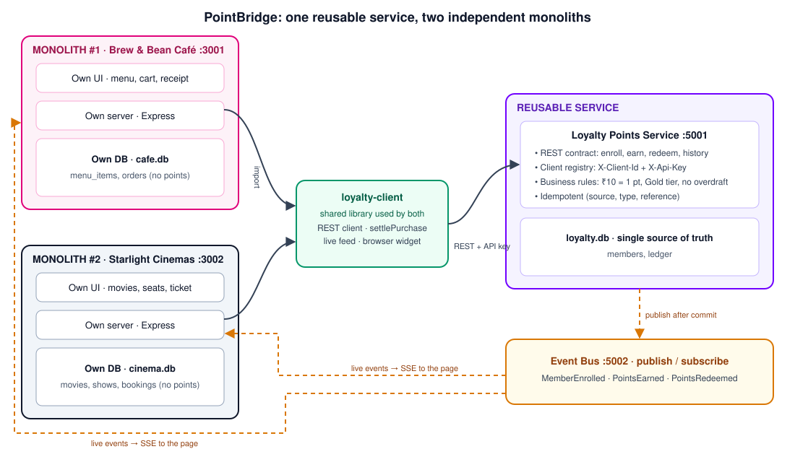
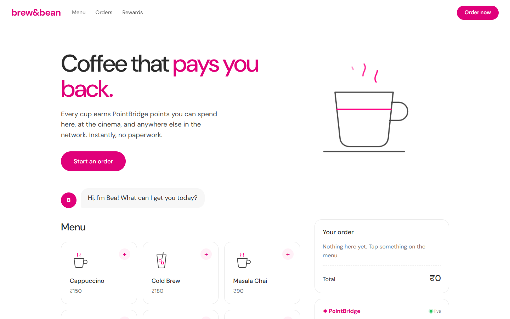
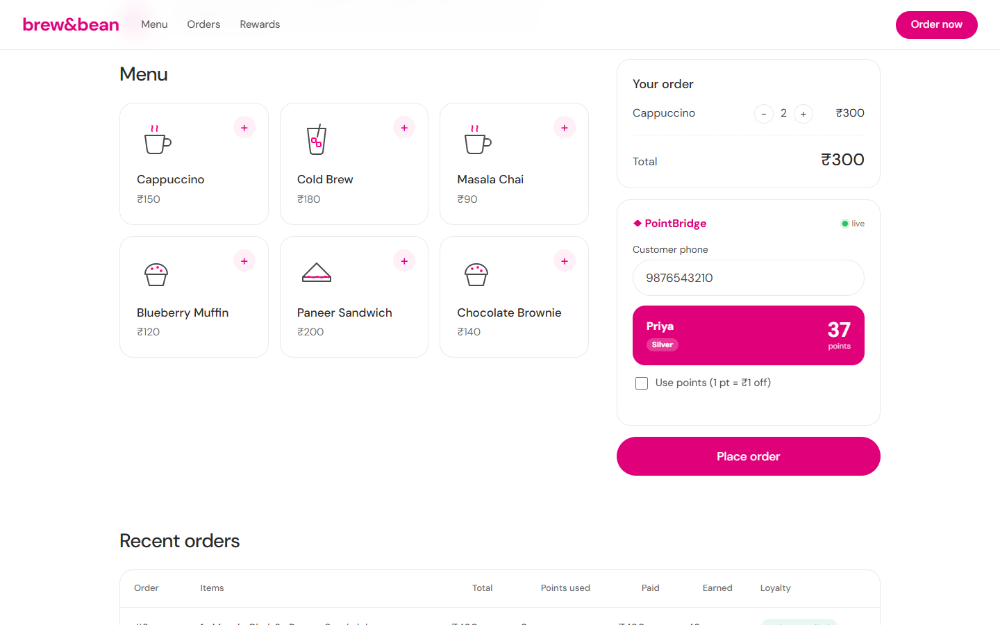
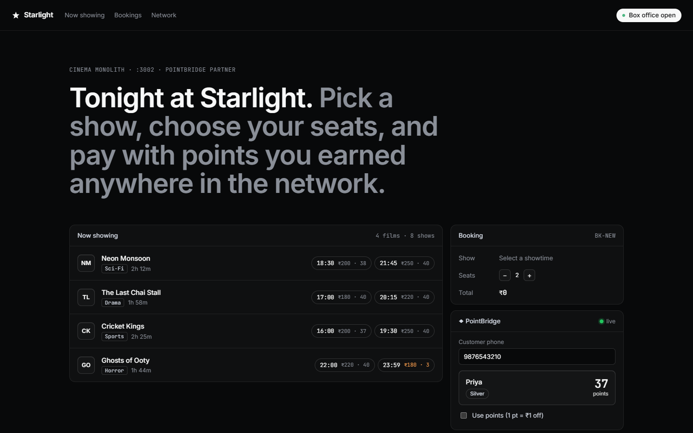
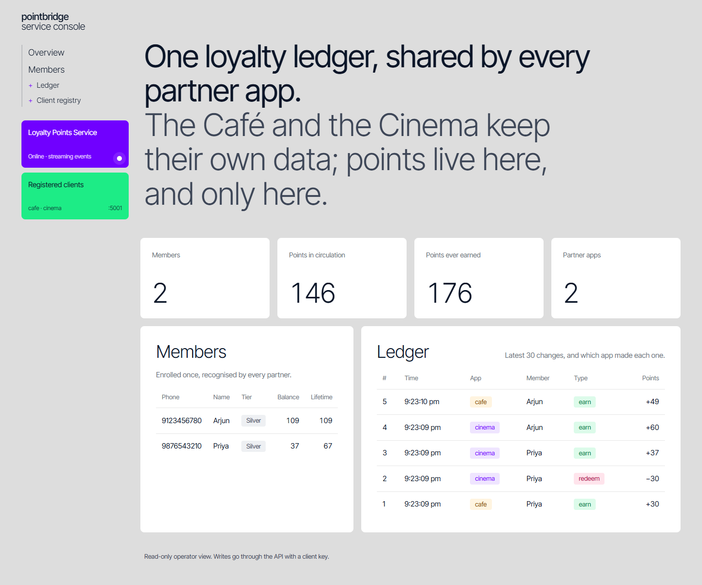
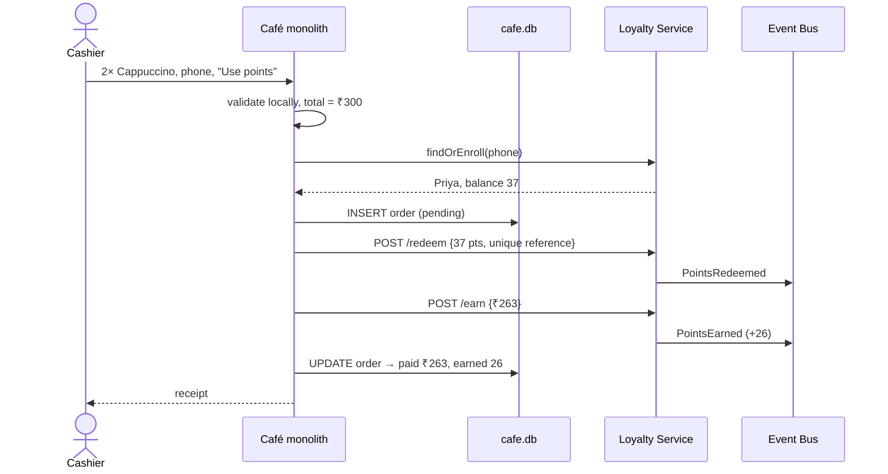
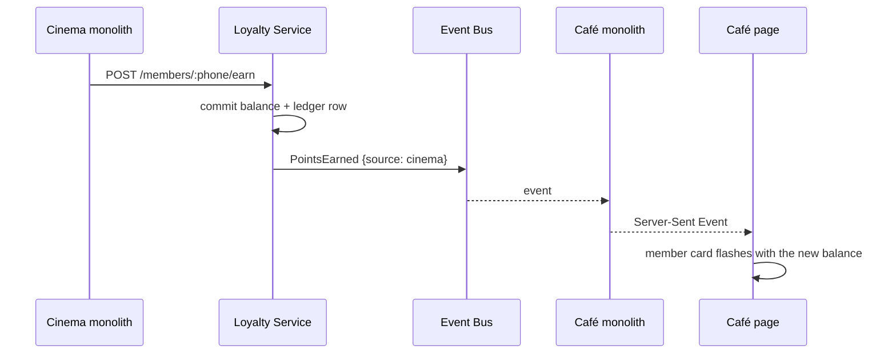
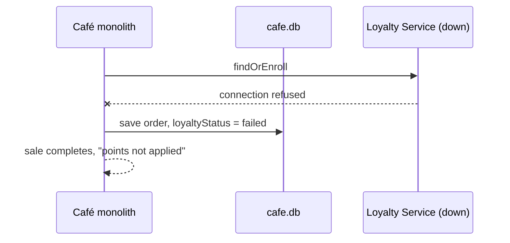

<div align="center">

# ◆ PointBridge

### One reusable service. Two independent monoliths. Zero duplicated logic.

A **Service-Oriented Architecture (SOA)** project: a single **Loyalty Points Service** is built once and reused by two separate monolithic applications. An update made through one application is reflected in the other instantly.

<br/>


[Problem](#-problem-statement) •
[Architecture](#-architecture) •
[Screenshots](#-screenshots) •
[How it works](#-how-it-works) •
[Run it](#-getting-started) •
[Demo](#-live-demo-script) •
[API](#-service-api)

</div>

---

## 📌 Problem Statement

In many organisations, several applications are built separately as **monolithic systems**. Each has its own server, database and user interface. When the same feature is needed in more than one of them, every application builds and maintains its own copy of it. That causes:

| Problem | Effect |
|---|---|
| 🔁 **Duplicated effort** | The same logic and rules are written, tested and maintained in every application |
| ⚠️ **Inconsistent data** | Each app keeps its own copy, so a change in one is not seen in the others |
| 🚫 **No reuse** | A feature built for one app cannot be used by another, even when the need is identical |
| 🔗 **Tight coupling** | Changing a common rule means modifying and redeploying every application |
| 📈 **Hard to extend** | Every new application builds the same feature again |

**Objective:** build a **reusable service**, use it in **two independent monolithic applications**, show that an **update in one is reflected in the other**, and demonstrate the core **SOA principles**.

---

## 💡 The Solution

Instead of the textbook *login service*, PointBridge implements a **coalition loyalty programme** (the model behind Payback or airline miles):

- 🟣 **Loyalty Points Service** is the reusable service. It owns members, balances and the ledger, and enforces every rule.
- ☕ **Brew & Bean Café** is monolith #1, a coffee shop point of sale.
- 🎬 **Starlight Cinemas** is monolith #2, a movie box office.
- 🟠 **Event Bus** delivers every change to all subscribers.

A customer earns points buying coffee and spends them on movie tickets. Both apps see the same balance, live.

---

## 🏗 Architecture

<p align="center">
  
</p>

| Component | Role | Port | Owns this data |
|---|---|:---:|---|
| **Loyalty Points Service** | The reusable service: REST contract, client registry, business rules | `5001` | `loyalty.db`: members, ledger |
| **Brew & Bean Café** | Monolith #1: own server, own DB, own UI | `3001` | `cafe.db`: menu, orders |
| **Starlight Cinemas** | Monolith #2: own server, own DB, own UI | `3002` | `cinema.db`: movies, shows, bookings |
| **Event Bus** | Publish/subscribe channel for live updates | `5002` | none |
| **loyalty-client** | Shared library both monoliths import: REST client, checkout flow, live feed, UI widget | n/a | none |

> Neither monolith stores points. The service is the **single source of truth**.

### SOA principles demonstrated

| Principle | Where you can see it |
|---|---|
| **Service reusability** | One service, consumed by two apps through the same `loyalty-client` library |
| **Standardised service contract** | Documented REST API with JSON errors ([API](#-service-api)) |
| **Loose coupling** | Stop the service and the Café still sells; orders are marked *points not applied* |
| **Service autonomy** | The service owns its own database; no app touches `loyalty.db` |
| **Governance / security** | A client registry with `X-Client-Id` and `X-Api-Key` on every call |
| **Event-driven integration** | Publish-after-commit to the Event Bus, relayed to browsers by SSE |
| **Reliability** | Idempotent references, a single retry on timeout, compensation (Saga-style) on failure |
| **Consistency** | An atomic `UPDATE … WHERE balance >= ?` means no double spending across apps |

---

## 📸 Screenshots

<table>
<tr>
<td width="50%"><b>☕ Monolith #1: Brew &amp; Bean Café</b><br/></td>
<td width="50%"><b>☕ Café checkout with the shared PointBridge widget</b><br/></td>
</tr>
<tr>
<td width="50%"><b>🎬 Monolith #2: Starlight Cinemas</b><br/><sub>The same customer, recognised with the balance earned at the Café</sub><br/></td>
<td width="50%"><b>🟣 Loyalty Service console</b><br/><sub>One ledger, with rows written by both <code>cafe</code> and <code>cinema</code></sub><br/></td>
</tr>
</table>

---

## ⚙ How It Works

### 1. Checkout: a monolith using the reusable service



### 2. An update in one monolith is reflected in the other



### 3. Loose coupling: the service is down



### Business rules (enforced once, in the service)

- 🪙 **Earn:** 1 point per ₹10 spent
- 💸 **Spend:** 1 point = ₹1 off
- 🥇 **Tier:** Gold at 500 lifetime points
- 🛡 **Never negative:** the balance cannot go below 0, enforced by a DB `CHECK` and an atomic update
- 🔂 **Idempotent:** the same `(client, type, reference)` is applied only once, so retries are safe

---

## 🚀 Getting Started

**Prerequisite:** [Node.js](https://nodejs.org/) **22.13 or newer**, for the built-in `node:sqlite`.

```bash
git clone https://github.com/KDHARSAN/pointbridge.git
cd pointbridge
npm run setup      # installs dependencies for every component
npm run dev        # starts the service, the bus and both monoliths
```

| Open | URL |
|---|---|
| ☕ Café | http://localhost:3001 |
| 🎬 Cinema | http://localhost:3002 |
| 🟣 Service console (read-only) | http://localhost:5001 |

> The Event Bus on `:5002` has no UI; it runs in the background.

**Run the tests:**

```bash
npm test
```

**Reset the demo data:** stop the servers and delete `*/*.db`. Menus and movies are seeded again on the next start.

<details>
<summary><b>Troubleshooting: <code>EADDRINUSE</code> / port already in use</b></summary>

Another copy is still running. Press Ctrl+C in that terminal, or in PowerShell run:

```powershell
foreach ($p in 3001,3002,5001,5002) { Get-NetTCPConnection -LocalPort $p -State Listen -ErrorAction SilentlyContinue | ForEach-Object { Stop-Process -Id $_.OwningProcess } }
```
</details>

---

## 🎬 Live Demo Script

Start the service separately, so it can be stopped on its own in step 5. Use two terminals:

```bash
npm run loyalty     # terminal 1: the reusable service
npm run dev:apps    # terminal 2: bus + both monoliths
```

| # | Step | Expected result |
|:-:|---|---|
| 1 | **Join in one app, recognised in the other.** At the Café, order 2× Cappuccino (₹300) with phone `9876543210`, name `Priya` | Priya joins and earns **30 pts**. Type the same phone at the Cinema and she appears with **30**, with no second sign-up |
| 2 | **Cinema → Café.** Book *Neon Monsoon 18:30*, 2 seats, tick **Use points** | ₹400 − 30 = **₹370 paid, +37 pts**. The Café card flashes to **37** |
| 3 | **Café → Cinema.** Order 1× Masala Chai (₹90) with **Use points** | **₹53 paid, +5 pts**. The Cinema card flashes to **5** |
| 4 | **No double spending.** Run `npm run race` | One app gets **200**, the other **409 Not enough points** |
| 5 | **Loose coupling.** Ctrl+C the `npm run loyalty` terminal and place a Café order | The sale still succeeds, marked **"points not applied"** |
| 6 | **The service owns the data.** Open the console on `:5001` | One ledger with rows from both `cafe` and `cinema` |

```text
$ npm run race
Balance before: 100 points. Both apps now try to spend all 100 at once…
  Café    -> HTTP 200 spent 100, balance 0
  Cinema  -> HTTP 409 Not enough points
```

---

## 📡 Service API

Every call needs the headers `X-Client-Id` (`cafe` or `cinema`) and `X-Api-Key`. Errors are returned as `{ "error": "..." }`.

| Method | Endpoint | Body | Result |
|:---:|---|---|---|
| `POST` | `/members` | `{ phone, name }` | `201` new member, or `200` if already enrolled |
| `GET` | `/members/:phone` | none | The member, or `404` |
| `POST` | `/members/:phone/earn` | `{ amount, reference }` | 1 point per ₹10 |
| `POST` | `/members/:phone/redeem` | `{ points, reference }` | `409` if the balance is too low |
| `GET` | `/members/:phone/transactions` | none | Ledger, newest first |
| `GET` | `/health`, `/admin/overview` | none | Open, read-only |

**Events published:** `MemberEnrolled` · `PointsEarned` · `PointsRedeemed`

<details>
<summary><b>Example request</b></summary>

```bash
curl -X POST http://localhost:5001/members/9876543210/earn \
  -H "Content-Type: application/json" \
  -H "X-Client-Id: cafe" -H "X-Api-Key: cafe-dev-key" \
  -d '{"amount": 300, "reference": "cafe-order-1"}'
```
</details>

---

## 📁 Project Structure

```text
pointbridge/
├── loyalty-service/        🟣 The reusable service
│   ├── src/app.js             REST contract, API-key check, rules, events
│   ├── src/repo.js            Atomic, idempotent points transactions
│   ├── src/db.js              members + ledger schema
│   ├── src/clients.js         Client registry (cafe, cinema)
│   └── public/index.html      Read-only service console
├── loyalty-client/         🟢 Shared library both monoliths import
│   ├── index.js               createLoyaltyClient, settlePurchase, live feed
│   └── browser/               PointBridge widget (JS + CSS)
├── cafe-app/               ☕ Monolith #1: server, cafe.db, UI
├── cinema-app/             🎬 Monolith #2: server, cinema.db, UI
├── event-bus/              🟠 Socket.IO publish / subscribe
├── scripts/race.mjs        Double-spend race demo
└── docs/                   Report, diagrams, PPT outline, screenshots
```

---

## ✅ Testing

**55 automated tests** using `node:test` and `supertest`:

| Component | Tests | Covers |
|---|:---:|---|
| Loyalty Service | 21 | Earn rate, no overdraft, idempotency, auth, validation, events |
| Event Bus | 2 | Publish and fan-out |
| loyalty-client | 4 | Retry, settle flow, errors |
| Café monolith | 18 | Checkout, guest orders, service down, compensation |
| Cinema monolith | 10 | Seat reservation, release on failure, points |

---

## 🧰 Tech Stack

| Layer | Technology |
|---|---|
| Runtime | Node.js 22 (ES modules) |
| Web framework | Express 4 |
| Database | SQLite via built-in `node:sqlite`, one DB per component |
| Messaging | Socket.IO event bus, with Server-Sent Events to browsers |
| Frontend | Vanilla HTML, CSS and JS, with a distinct design per app |
| Testing | `node:test` + supertest |
| Orchestration | `concurrently` |

---

## 📚 Documentation

- 📄 [Project report](docs/report.md)
- 🗺 [Architecture diagrams (Mermaid)](docs/architecture.md)
- 🎤 [Presentation outline](docs/ppt-outline.md)

## 🔭 Future Scope

An API gateway with OAuth2 client credentials · PostgreSQL · a transactional outbox to Kafka · horizontal scaling on Kubernetes · more partner applications · analytics and fraud detection.

---

<div align="center">

**Built by [DHARSAN K](https://github.com/KDHARSAN)** for **21CSE457T: Service Oriented Architecture**

⭐ If this project helped you understand SOA, consider starring the repo.

</div>
