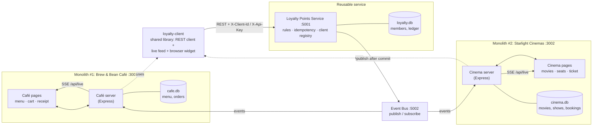
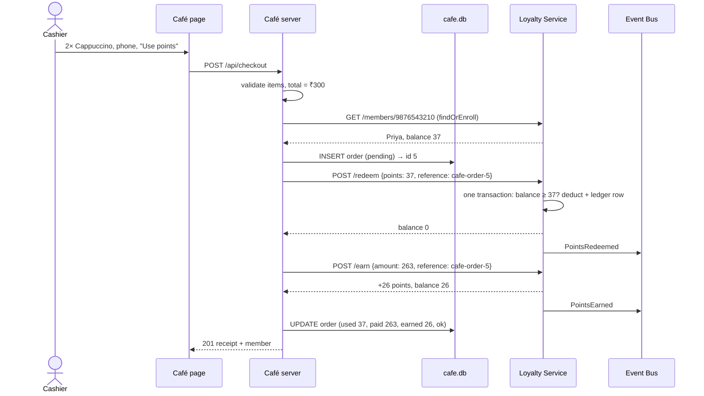
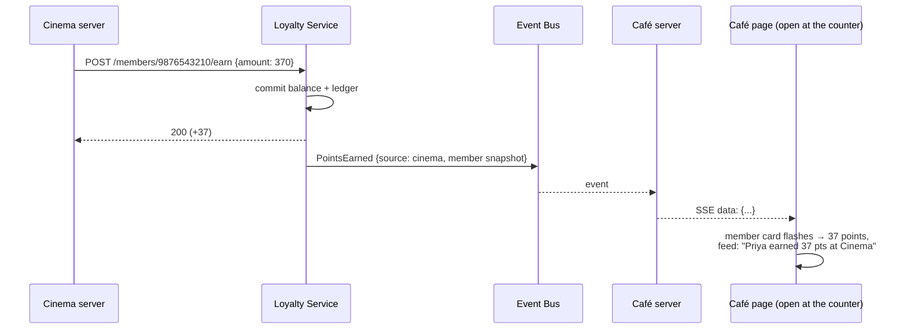
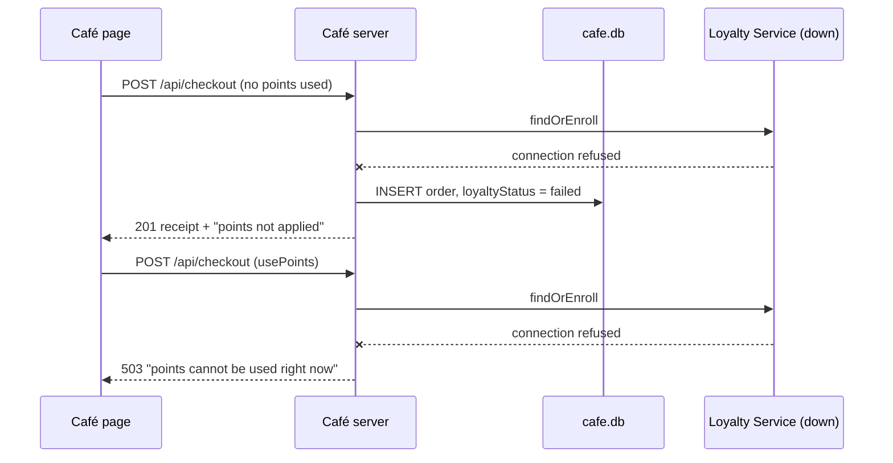
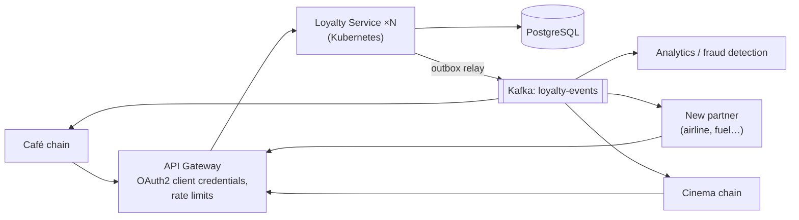

# PointBridge: Architecture Diagrams

These are Mermaid diagrams. Paste each block into https://mermaid.live to export a PNG for the report or slides.

## 1. Component diagram: one service, two monoliths

## 2. Sequence: a Café checkout (spending and earning points)

## 3. Sequence: an update in one monolith shows up in the other

## 4. Sequence: the Loyalty Service is down (loose coupling)

## 5. Production architecture (future work)

